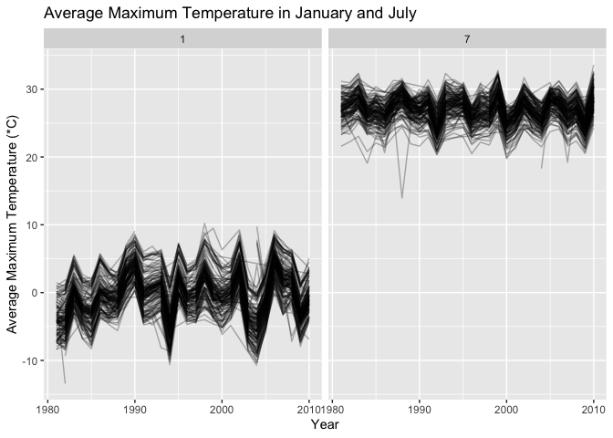
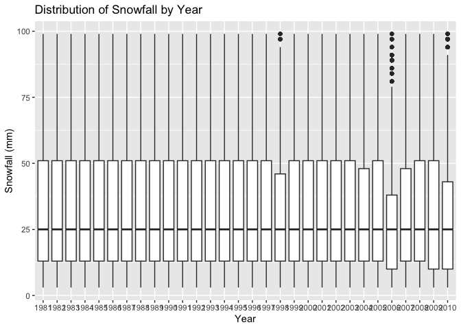
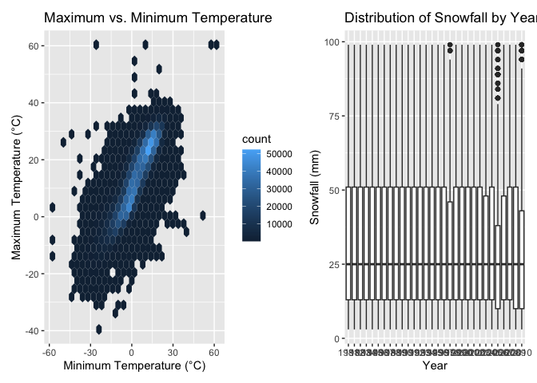
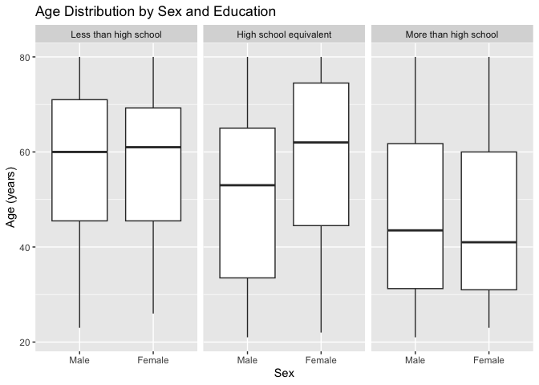
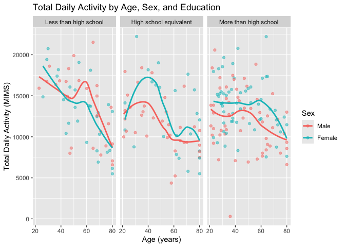
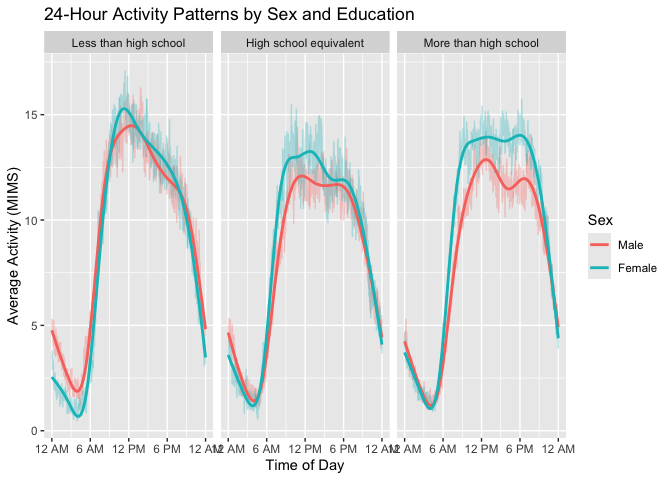
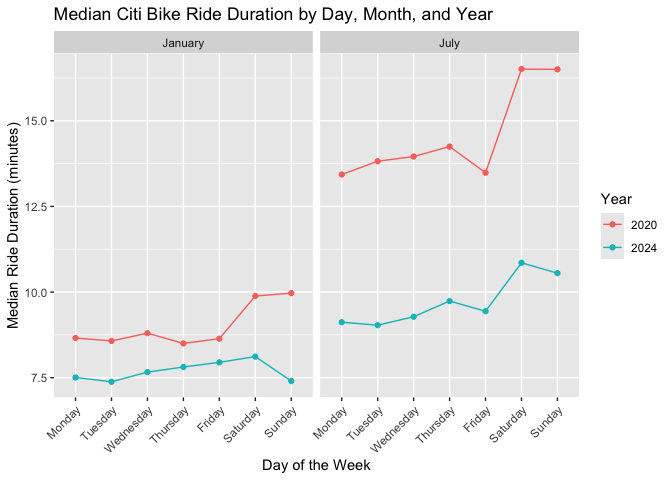
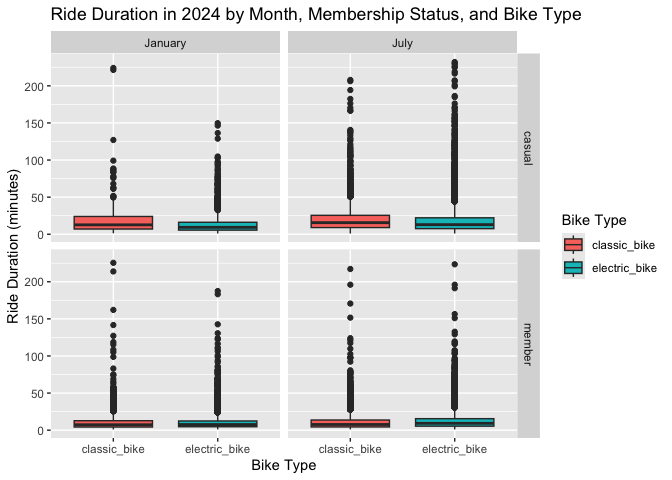

p8105_hw3_ll3969
================
Lauren Littig
2026-10-14

# Problem 1

``` r
library(tidyverse)
```

    ## ── Attaching core tidyverse packages ──────────────────────── tidyverse 2.0.0 ──
    ## ✔ dplyr     1.2.1     ✔ readr     2.2.0
    ## ✔ forcats   1.0.1     ✔ stringr   1.6.0
    ## ✔ ggplot2   4.0.3     ✔ tibble    3.3.1
    ## ✔ lubridate 1.9.5     ✔ tidyr     1.3.2
    ## ✔ purrr     1.2.2     
    ## ── Conflicts ────────────────────────────────────────── tidyverse_conflicts() ──
    ## ✖ dplyr::filter() masks stats::filter()
    ## ✖ dplyr::lag()    masks stats::lag()
    ## ℹ Use the conflicted package (<http://conflicted.r-lib.org/>) to force all conflicts to become errors

``` r
library(p8105.datasets)
library(patchwork)
data("ny_noaa")
view(ny_noaa)
```

`ny_noaa` has 2595176 observations and 7 variables (id, date, prcp,
snow, snwd, tmax, tmin).

Exploratory analyses (describing some key variables, and indicating the
extent to which missing data is an issue):

``` r
ny_noaa |>
  summarize(across(id:tmin, ~mean(is.na(.x))) * 100)
```

    ## # A tibble: 1 × 7
    ##      id  date  prcp  snow  snwd  tmax  tmin
    ##   <dbl> <dbl> <dbl> <dbl> <dbl> <dbl> <dbl>
    ## 1     0     0  5.62  14.7  22.8  43.7  43.7

Missing data are an issue in this dataset. 43.7% of maximum and minimum
temperature observations are missing. Snow depth is missing 14.7% and
precipitation is missing 5.6%. There are no missing values for ID or
date.

### Do some data cleaning. Create separate variables for year, month, and day. Ensure observations for temperature, precipitation, and snowfall are given in reasonable units. For snowfall, what are the most commonly observed values? Why?

``` r
ny_noaa =
  ny_noaa |>
  mutate(
    year = lubridate::year(date),
    month = lubridate::month(date),
    day = lubridate::day(date)
  )

ny_noaa =
  ny_noaa |>
  mutate(
    tmax = as.numeric(tmax) / 10,
    tmin = as.numeric(tmin) / 10,
    prcp = prcp / 10
  )

ny_noaa |> 
  count(snow) |> 
  arrange(desc(n))
```

    ## # A tibble: 282 × 2
    ##     snow       n
    ##    <int>   <int>
    ##  1     0 2008508
    ##  2    NA  381221
    ##  3    25   31022
    ##  4    13   23095
    ##  5    51   18274
    ##  6    76   10173
    ##  7     8    9962
    ##  8     5    9748
    ##  9    38    9197
    ## 10     3    8790
    ## # ℹ 272 more rows

The most commonly observed snowfall value is 0 which makes sense because
days with no snow all report the same value, whereas days with snow have
different measurements in mm so days with one specific measurement are
less common than a day with 0 mm.

## Make a two-panel plot showing the average max temperature in January and in July in each station across years. Is there any observable / interpretable structure? Any outliers?

``` r
plot_maxtemp =
  ny_noaa |> 
  filter(month %in% c(1, 7), !is.na(tmax)) |>
  group_by(id, year, month) |> 
  summarize(mean_tmax = mean(tmax), .groups = "drop") |> 
  ggplot(aes(x = year, y = mean_tmax, group = id)) +
  geom_line(alpha = 0.3) +
  facet_grid(. ~ month) +
  labs(
    title = "Average Maximum Temperature in January and July",
    x = "Year",
    y = "Average Maximum Temperature (*C)"
  )

plot_maxtemp
```

<!-- -->

Average maximum temperatures are consistently higher in July than in
January across all weather stations and years. There is no obvious
consistent increasing or decreasing trend over the study period. A few
potential outliers are visible, particularly a station with an unusually
low average maximum temperature of approximately 14°C in July around
1988 and another with a January average below −13°C in the early 1980s.
These outliers could reflect unusual weather conditions, geographic
differences between stations, or incomplete observations.

### Make a two-panel plot showing (i) tmax vs tmin for the full dataset (note that a scatterplot may not be the best option); and (ii) make a plot showing the distribution of snowfall values greater than 0 and less than 100 separately by year.

``` r
plot_temp =
  ny_noaa |>
  ggplot(aes(x = tmin, y = tmax)) +
  geom_hex() +
  labs(
    title = "Maximum vs. Minimum Temperature",
    x = "Minimum Temperature (°C)",
    y = "Maximum Temperature (°C)"
  )

plot_temp
```

    ## Warning: Removed 1136276 rows containing non-finite outside the scale range
    ## (`stat_binhex()`).

<!-- -->

``` r
plot_snow =
  ny_noaa |>
  filter(snow > 0, snow < 100) |>
  ggplot(aes(x = factor(year), y = snow)) +
  geom_boxplot() +
  labs(
    title = "Distribution of Snowfall by Year",
    x = "Year",
    y = "Snowfall (mm)"
  )

plot_snow
```

<!-- -->

``` r
plot_temp + plot_snow
```

    ## Warning: Removed 1136276 rows containing non-finite outside the scale range
    ## (`stat_binhex()`).

<!-- -->

# Problem 2

Load, tidy, merge, and otherwise organize the data sets. Your final
dataset should include all originally observed variables; exclude
participants less than 21 years of age, and those with missing
demographic data; and encode data with reasonable variable classes
(i.e. not numeric, and using factors with the ordering of tables and
plots in mind).

``` r
nhanes_covar = 
  read_csv("data/nhanes_covar.csv", skip = 4) |>
  filter(age >= 21) |> 
  drop_na() |> 
  mutate(
    sex = case_match(
      sex,
      1 ~ "Male",
      2 ~ "Female"
    ),
    education = case_match(
      education,
      1 ~ "Less than high school",
      2 ~ "High school equivalent",
      3 ~ "More than high school"
    ),
    sex = factor(sex, levels = c("Male", "Female")),
    education = factor(
      education,
      levels = c(
        "Less than high school",
        "High school equivalent",
        "More than high school"
      )
    )
  ) |> 
  janitor::clean_names()
```

    ## Rows: 250 Columns: 5
    ## ── Column specification ────────────────────────────────────────────────────────
    ## Delimiter: ","
    ## dbl (5): SEQN, sex, age, BMI, education
    ## 
    ## ℹ Use `spec()` to retrieve the full column specification for this data.
    ## ℹ Specify the column types or set `show_col_types = FALSE` to quiet this message.

    ## Warning: There was 1 warning in `mutate()`.
    ## ℹ In argument: `sex = case_match(sex, 1 ~ "Male", 2 ~ "Female")`.
    ## Caused by warning:
    ## ! `case_match()` was deprecated in dplyr 1.2.0.
    ## ℹ Please use `recode_values()` instead.

``` r
nhanes_accel =
  read_csv("data/nhanes_accel.csv") |>
  janitor::clean_names() |> 
  pivot_longer(
    min1:min1440,
    names_to = "minute",
    names_prefix = "min",
    values_to = "mims"
  ) |> 
  mutate(
    minute = as.numeric(minute)
  )
```

    ## Rows: 250 Columns: 1441
    ## ── Column specification ────────────────────────────────────────────────────────
    ## Delimiter: ","
    ## dbl (1441): SEQN, min1, min2, min3, min4, min5, min6, min7, min8, min9, min1...
    ## 
    ## ℹ Use `spec()` to retrieve the full column specification for this data.
    ## ℹ Specify the column types or set `show_col_types = FALSE` to quiet this message.

``` r
nhanes_df =
  left_join(nhanes_covar, nhanes_accel, by = "seqn")
```

### Produce a reader-friendly table for the number of men and women in each education category, and create a visualization of the age distributions for men and women in each education category. Comment on these items.

``` r
nhanes_df |>
  distinct(seqn, sex, education) |>
  count(education, sex) |>
  pivot_wider(
    names_from = sex,
    values_from = n
  ) |>
  knitr::kable()
```

| education              | Male | Female |
|:-----------------------|-----:|-------:|
| Less than high school  |   27 |     28 |
| High school equivalent |   35 |     23 |
| More than high school  |   56 |     59 |

``` r
nhanes_df |>
  distinct(seqn, sex, education, age) |>
  ggplot(aes(x = sex, y = age)) +
  geom_boxplot() +
  facet_grid(. ~ education) +
  labs(
    title = "Age Distribution by Sex and Education",
    x = "Sex",
    y = "Age (years)"
  )
```

<!-- -->

Participants with less than a high school education tend to be older,
with median ages around 60–61 years for both men and women. Participants
with a high school equivalent education have more variation in age
between sexes, with a median age of approximately 53 years for men and
62 years for women. Participants with more than a high school education
tend to be younger, with median ages of approximately 44 years for men
and 41 years for women. Overall, participants with higher education
levels tend to be younger, and the largest difference in median age
between men and women is observed in the high school equivalent
category.

### Traditional analyses of accelerometer data focus on the total activity over the day. Using your tidied dataset, aggregate across minutes to create a total activity variable for each participant. Plot these total activities (y-axis) against age (x-axis); your plot should compare men to women and have separate panels for each education level. Include a trend line or a smooth to illustrate differences. Comment on your plot.

``` r
nhanes_total =
  nhanes_df |>
  group_by(seqn, age, sex, education) |>
  summarize(
    total_activity = sum(mims, na.rm = TRUE),
    .groups = "drop"
  )

nhanes_total |>
  ggplot(aes(x = age, y = total_activity, color = sex)) +
  geom_point(alpha = 0.5) +
  geom_smooth(se = FALSE) +
  facet_grid(. ~ education) +
  labs(
    title = "Total Daily Activity by Age, Sex, and Education",
    x = "Age (years)",
    y = "Total Daily Activity (MIMS)",
    color = "Sex"
  )
```

    ## `geom_smooth()` using method = 'loess' and formula = 'y ~ x'

<!-- -->

Total daily activity generally decreases with increasing age across all
three education categories, although there is considerable variability
between participants. Among participants with less than a high school
education, men and women have relatively similar activity levels, with a
particularly steep decline after approximately age 60. Among
participants with a high school equivalent education, women tend to have
higher total daily activity than men between approximately ages 30 and
55, but activity levels become more similar at older ages. Among
participants with more than a high school education, women generally
have higher activity levels than men, although both groups show
declining activity with age. There is also a notable outlier in this
group, with a male participant around age 35 having almost no recorded
activity.

### Accelerometer data allows the inspection activity over the course of the day. Make a three-panel plot that shows the 24-hour activity time courses for each education level and use color to indicate sex. Describe in words any patterns or conclusions you can make based on this graph; including smooth trends may help identify differences.

``` r
nhanes_df |>
  group_by(education, sex, minute) |>
  summarize(
    mean_mims = mean(mims, na.rm = TRUE),
    .groups = "drop"
  ) |>
  ggplot(aes(x = minute, y = mean_mims, color = sex)) +
  geom_line(alpha = 0.3) +
  geom_smooth(se = FALSE) +
  facet_grid(. ~ education) +
  scale_x_continuous(
    breaks = c(1, 361, 721, 1081, 1440),
    labels = c("12 AM", "6 AM", "12 PM", "6 PM", "12 AM")
  ) +
  labs(
    title = "24-Hour Activity Patterns by Sex and Education",
    x = "Time of Day",
    y = "Average Activity (MIMS)",
    color = "Sex"
  )
```

    ## `geom_smooth()` using method = 'gam' and formula = 'y ~ s(x, bs = "cs")'

<!-- -->

Across all three education levels, average activity is lowest overnight,
increases sharply in the early morning, remains relatively high
throughout the day, and declines in the evening. Participants with less
than a high school education appear to have the highest peak activity
levels, particularly in the morning, while those with a high school
equivalent education generally have lower daytime activity levels. Women
tend to have higher daytime activity than men across all three education
categories, although the difference is most pronounced among
participants with more than a high school education. In this group,
women have consistently higher average activity throughout much of the
day, while men and women have more similar activity levels overnight.
Overall, the general daily activity patterns are similar across
education levels, but the magnitude of activity and differences between
sexes vary.

# Problem 3

### Import, clean, and tidy these data, and describe the resulting dataset.

``` r
citibike_012020 =
  read_csv("data/citibike/Jan 2020 Citi.csv.zip") |>
  mutate(
    year = 2020,
    month = "January"
  ) |> 
  janitor::clean_names()
```

    ## Rows: 12420 Columns: 7
    ## ── Column specification ────────────────────────────────────────────────────────
    ## Delimiter: ","
    ## chr (6): ride_id, rideable_type, weekdays, start_station_name, end_station_n...
    ## dbl (1): duration
    ## 
    ## ℹ Use `spec()` to retrieve the full column specification for this data.
    ## ℹ Specify the column types or set `show_col_types = FALSE` to quiet this message.

``` r
citibike_012024 =
  read_csv("data/citibike/Jan 2024 Citi.csv.zip") |>
  mutate(
    year = 2024,
    month = "January"
  ) |>
  janitor::clean_names()
```

    ## Rows: 18861 Columns: 7
    ## ── Column specification ────────────────────────────────────────────────────────
    ## Delimiter: ","
    ## chr (6): ride_id, rideable_type, weekdays, start_station_name, end_station_n...
    ## dbl (1): duration
    ## 
    ## ℹ Use `spec()` to retrieve the full column specification for this data.
    ## ℹ Specify the column types or set `show_col_types = FALSE` to quiet this message.

``` r
citibike_072020 =
  read_csv("data/citibike/July 2020 Citi.csv.zip") |>
  mutate(
    year = 2020,
    month = "July"
  ) |>
  janitor::clean_names()
```

    ## Rows: 21048 Columns: 7
    ## ── Column specification ────────────────────────────────────────────────────────
    ## Delimiter: ","
    ## chr (6): ride_id, rideable_type, weekdays, start_station_name, end_station_n...
    ## dbl (1): duration
    ## 
    ## ℹ Use `spec()` to retrieve the full column specification for this data.
    ## ℹ Specify the column types or set `show_col_types = FALSE` to quiet this message.

``` r
citibike_072024 =
  read_csv("data/citibike/July 2024 Citi.csv.zip") |>
  mutate(
    year = 2024,
    month = "July"
  ) |>
  janitor::clean_names()
```

    ## Rows: 47156 Columns: 7
    ## ── Column specification ────────────────────────────────────────────────────────
    ## Delimiter: ","
    ## chr (6): ride_id, rideable_type, weekdays, start_station_name, end_station_n...
    ## dbl (1): duration
    ## 
    ## ℹ Use `spec()` to retrieve the full column specification for this data.
    ## ℹ Specify the column types or set `show_col_types = FALSE` to quiet this message.

``` r
citibike_df =
  bind_rows(
    citibike_012020,
    citibike_012024,
    citibike_072020,
    citibike_072024
  ) |>
  mutate(
    month = factor(month, levels = c("January", "July")),
    weekdays = factor(
      weekdays,
      levels = c(
        "Monday", "Tuesday", "Wednesday", "Thursday",
        "Friday", "Saturday", "Sunday"
      )
    ),
    member_casual = factor(member_casual),
    rideable_type = factor(rideable_type)
  )
```

`citibike_df` contains 99485 observations and 9 variables (ride_id,
rideable_type, weekdays, duration, start_station_name, end_station_name,
member_casual, year, month). Each observation represents an individual
Citi Bike ride in January or July of 2020 or 2024. The dataset contains
a 1% sample of rides lasting less than four hours.

The variables include ride ID (`ride_id`), bike type (`rideable_type`),
day of the week (`weekdays`), ride duration in minutes (`duration`),
starting and ending station names (`start_station_name` and
`end_station_name`), membership status (`member_casual`), year, and
month.

The datasets were combined using `bind_rows()`, and year and month
variables were added to identify when each ride occurred. Month,
weekday, membership status, and bike type were converted to factors,
with month and weekday ordered chronologically.

### Produce a reader-friendly table showing the total number of rides in each combination of year and month separating casual riders and Citi Bike members. Comment on these results.

``` r
citibike_df |>
  count(year, month, member_casual) |>
  pivot_wider(
    names_from = member_casual,
    values_from = n
  ) |>
  knitr::kable(
    caption = "Citi Bike Rides by Year, Month, and Membership"
  )
```

| year | month   | casual | member |
|-----:|:--------|-------:|-------:|
| 2020 | January |    984 |  11436 |
| 2020 | July    |   5637 |  15411 |
| 2024 | January |   2108 |  16753 |
| 2024 | July    |  10894 |  36262 |

Citi Bike Rides by Year, Month, and Membership

The number of Citi Bike rides increased substantially from 2020 to 2024
for both casual riders and members. Members accounted for the majority
of rides in all four months, although casual rides also increased
considerably. In both years, the number of rides was much higher in July
than in January, likely reflecting warmer weather and more favorable
biking conditions. July 2024 had the highest number of rides (47,156),
while January 2020 had the lowest (12,420).

### Make a table showing the 5 most popular starting stations for July 2024; include the number of rides originating from these stations.

``` r
citibike_df |>
  filter(year == 2024, month == "July") |>
  count(start_station_name) |>
  arrange(desc(n)) |>
  head(5) |>
  knitr::kable(
    caption = "Five Most Popular Starting Stations in July 2024"
  )
```

| start_station_name       |   n |
|:-------------------------|----:|
| Pier 61 at Chelsea Piers | 163 |
| University Pl & E 14 St  | 155 |
| W 21 St & 6 Ave          | 152 |
| West St & Chambers St    | 150 |
| W 31 St & 7 Ave          | 146 |

Five Most Popular Starting Stations in July 2024

### Make a plot to investigate the effects of day of the week, month, and year on median ride duration. This plot can include one or more panels, but should facilitate comparison across all variables of interest. Comment on your observations from this plot.

``` r
plot_citibike_median =
  citibike_df |>
  group_by(year, month, weekdays) |>
  summarize(
    median_duration = median(duration, na.rm = TRUE),
    .groups = "drop"
  ) |>
  ggplot(aes(
    x = weekdays,
    y = median_duration,
    color = factor(year),
    group = factor(year)
  )) +
  geom_point() +
  geom_line() +
  facet_grid(. ~ month) +
  labs(
    title = "Median Citi Bike Ride Duration by Day, Month, and Year",
    x = "Day of the Week",
    y = "Median Ride Duration (minutes)",
    color = "Year"
  ) +
  theme(axis.text.x = element_text(angle = 45, hjust = 1))

plot_citibike_median
```

<!-- -->

Median Citi Bike ride duration was consistently higher in July than in
January and in 2020 compared to 2024 across all days of the week. In
both years and months, median ride duration was generally longer on
weekends. Median ride durations in January 2024 were relatively
consistent throughout the week. Overall, these patterns may reflect
greater recreational bike use during warmer months and on weekends,
while the shorter durations in 2024 could suggest changes in how Citi
Bikes are being used over time.

### There were relatively few electric Citi Bikes in 2020, but many more are available now. For data in 2024, make a figure that shows the impact of month, membership status, and bike type on the distribution of ride duration. Comment on your results.

``` r
citibike_df |>
  filter(year == 2024) |>
  ggplot(aes(x = rideable_type, y = duration, fill = rideable_type)) +
  geom_boxplot() +
  facet_grid(member_casual ~ month) +
  labs(
    title = "Ride Duration in 2024 by Month, Membership Status, and Bike Type",
    x = "Bike Type",
    y = "Ride Duration (minutes)",
    fill = "Bike Type"
  )
```

<!-- -->

In 2024, casual riders generally had longer ride durations than members,
particularly for classic bikes. Among casual riders, classic bikes had
higher median ride durations than electric bikes in both January and
July. In contrast, members had relatively similar ride durations across
bike types in January, while electric bikes had slightly longer median
ride durations than classic bikes in July. Across all groups, the
distributions were right-skewed, with most rides being relatively short
but some lasting more than 200 minutes.
